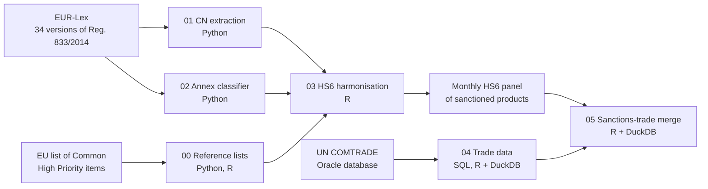
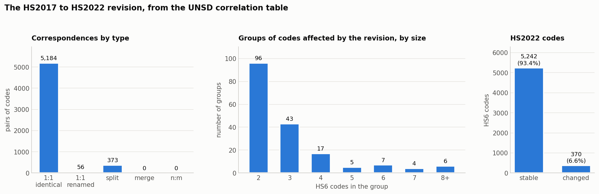

# EU sanctions on Russia: from legal texts to trade data

I wrote this code during my scientific traineeship at the European Commission's Joint Research Centre (Unit T.5, Data Intelligence for Policy, March to August 2026). The project asks whether goods sanctioned by the EU after 2022 keep reaching Russia through third countries, and whether this leaves a trace in trade statistics.

To answer that question, the sanctions first had to become data. The pipeline reads every consolidated version of Council Regulation (EU) No 833/2014 from EUR-Lex, extracts the product codes listed in its annexes, classifies the type of measure each annex carries, and turns the result into a monthly panel of sanctioned HS6 products. The trade side is extracted with SQL from UN COMTRADE: about 226 million monthly records on flows between the EU, Russia and Belarus, and transit countries, merged and checked with R and DuckDB. The last step attaches the sanctions panel to every trade record.

This repository shows the Russia side of the pipeline. The Belarus side (Regulation (EC) No 765/2006, 51 legal versions) follows the same steps. No data are included.

## The pipeline

## What is in each folder

**`00_reference_lists/`**
- `GENERAL-CLEAN_CHPI_Extraction.ipynb` reads the EU list of Common High Priority items (a PDF) and writes one row per HS code with its tier.
- `GENERAL-Finding_the_50_CHPI.R` checks in which legal versions, and in which annexes, each of the 50 items appears.

**`01_cn_extraction/`** (Python, Google Colab)
- Downloads the 34 consolidated versions of Regulation 833/2014 through the EUR-Lex API and parses the annex tables with BeautifulSoup.
- Writes one CSV of CN codes per version, with a quality report per version and checks against the HS nomenclature in force (HS2012, HS2017 or HS2022).
- The later cells flag "ex" codes whose description excludes some products (about 1,300 occurrences, sorted for manual review), build graph-ready summaries, and compare the output of two runs of the extractor.

**`02_annex_classifier/`** (Python, Google Colab)
- Parses the articles of every version and tags each (article, paragraph, annex) with the type of measure: export ban, import ban, transit ban, no-re-export clause, price cap, authorisation requirement. About 1,600 provisions in total.
- Keeps the snippet of legal text that triggered each tag, so that every choice can be checked.
- The last cell is an audit that surfaces the provisions the classifier could not tag.

**`03_hs6_harmonisation/`** (R)
- `step_1` removes redundant "ex" codes within each annex and logs every row it drops.
- `step_2` brings every code to HS6 in the HS vintage in force for that legal version. It expands chapter- and heading-level entries, handles catch-all codes and "except" clauses, and stops if any input row is lost on the way.
- `step_2B` builds a dual-use lookup from the Commission's correlation table for Annex VII.
- `step_3` combines products and annex directions into a monthly on/off panel per HS6 and per type of measure, with sanctioning, de-listing and re-listing dates. It stops if a legal version is missing, because that would create fake de-listings.
- `step_3B` counts sanctioned products per month by goods category and direction.
- `GENERAL-HS_correlation_build` reads the UNSD correlation table between HS2017 and HS2022, classifies every correspondence (identical, renamed, split, merge), groups linked codes into families with a union-find algorithm, and checks the result against the HS reference used in the rest of the pipeline. It also draws summary figures. COMTRADE switches nomenclature in 2022, so this tells which products can be compared before and after.

*The numbers produced by `GENERAL-HS_correlation_build`: types of correspondence, size of the groups of codes changed by the revision, and share of HS2022 codes that stay stable. The script draws the same panels as separate PNG files.*

**`04_trade_data/`** (SQL, R + DuckDB)
- `SQL-Views_LARGER` defines 12 Oracle views on UN COMTRADE monthly HS6 data, January 2010 to December 2026: exports and imports between the 27 EU countries, Russia and Belarus, and 34 transit partners (Central Asia and the Caucasus, Türkiye, the Western Balkans, China, India, Iran, the UAE, the Gulf and tax havens). It ends with verification queries that compare row counts with an earlier, smaller extraction.
- `LARGER_aggstructure_probe` checks whether some flows are reported only as totals, before choosing the filtering rule for the merge.
- `RU-BY-LARGER_MERGE_slim_v3` merges 28 CSV extracts (about 90 GB) into one dataset of 225,770,978 rows, January 2010 to December 2025. It reconciles rows and values for each of the 12 views before and after writing. The header lists the bugs met on real data and how they were fixed.
- `RU-BY-LARGER_descrittive` computes descriptive statistics on the merged dataset and reconciles them again with the merge summary.

**`05_sanctions_trade_merge/`** (R + DuckDB)
- `RU-BY-HS6_sanctions_lookup` builds two tables over the full universe of HS6 codes, one for export bans and one for import bans. For Russia and Belarus they give whether and when each product was sanctioned, de-listed and re-listed (up to three episodes), whether it is a high-priority or dual-use item, and in which HS vintages the code exists.
- `RU-BY-MERGE_slim_EXP_3flags` attaches the export-ban panel to the trade data and builds the estimation dataset (41,446,891 rows from the first, smaller extraction). Each record gets three flags (ever sanctioned, ever de-listed, sanctioned in that month), resolved by country: flows with Russia take the Russian panel, flows with Belarus the Belarusian one. Trade values are kept as text, exactly as reported, because the Benford tests downstream need the original digits. The script stops if the number of rows or columns is not the expected one.

## How the code is built

- Every run writes to a new timestamped folder, so nothing is ever overwritten.
- Scripts stop when a check fails (rows lost, versions missing, counts that do not match) instead of writing a wrong file.
- Every dropped or unresolved record goes to an audit file.
- The headers record design decisions and the bugs found along the way, for example non-breaking spaces inside EUR-Lex tables, end-of-line characters inside COMTRADE flags, and a comma in "China, Hong Kong SAR" that broke CSV parsing.
- File names carry a date and a version, and the prefixes RU-, BY- and GENERAL- say which country the file covers.

## Running the code

- The notebooks were written for Google Colab. The first cells list the input files to upload.
- In the R scripts, set the folders at the top (`BASE_DIR`, `REF_DIR`, `DIR_LARGER`, `SLIM`, `RU`, `BY`). Packages: dplyr, dbplyr, readr, tidyr, stringr, purrr, lubridate, readxl, data.table, DBI, duckdb.
- Python packages are listed in `requirements.txt`.
- The SQL views ran on an Oracle copy of the UN COMTRADE bulk files. Schema names are replaced with placeholders (`MY_SCHEMA`, `REF_SCHEMA`).
- EUR-Lex texts are public and the notebooks download them. UN COMTRADE data are not included: they are subject to their own licence.
- Comments are in English. Some console messages and variable names in `04_trade_data/` are in Italian, the working language of the project.

## Notes

I used AI coding assistants to write this code. The research design, the decisions recorded in the scripts and the checks on real data are mine.

The views expressed here are my own and do not represent the European Commission.

## Author

Michele Ceraolo, PhD in Economics
[Website](https://sites.google.com/view/michele-ceraolo) · [LinkedIn](https://www.linkedin.com/in/michele-ceraolo/) · [Google Scholar](https://scholar.google.com/citations?user=cDjs3qAAAAAJ)
